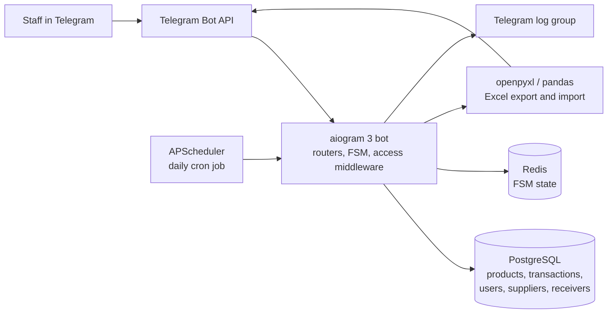
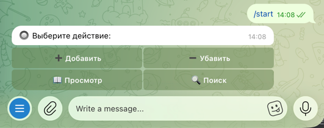
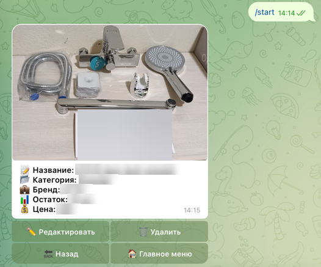
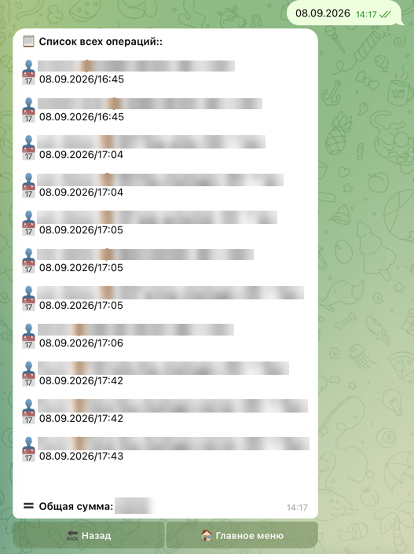

# Warehouse Management Bot

A Telegram bot that runs the daily inventory operations of a retail business
with roughly 12 staff members. Warehouse and shop staff record every stock
movement through the bot — goods received from suppliers, goods handed out to
recipients — browse the catalogue, search it, pull reports for a product,
a supplier, a recipient or a whole day, and exchange the product table with
the office as a formatted Excel file. The bot posts a summary of the day's
operations to every registered user on a schedule. It was in production use
from 12/2023 to 11/2024.

## Features

**Role-based access.** Access is enforced by middleware on every message and
callback: a user who is not on the whitelist table is refused before any
handler runs. Beyond the whitelist there are two roles. Administrators get the
full menu and can whitelist new users with a command. Shop accounts get a
reduced menu with view and search only — they can read the catalogue but
cannot change stock levels.

**Inventory operations.** Stock-in and stock-out share a guided drill-down:
pick the supplier or recipient, then the category, then the brand, then the
product, then enter the quantity and price. Long lists are paginated inline
keyboards, and every screen has working back navigation that restores the
previous step's state. New suppliers and recipients can be created inline
during the flow. Products carry a photo, which is shown on the product card
along with the current quantity and price; administrators can edit any field
of a product, replace its photo, or delete it behind a confirmation step.

**Transaction ledger.** Every movement is written to a transactions table with
the product, quantity, price, the counterparty, and a timestamp — stock levels
and the history that produced them are kept separately, so reports are
reconstructed from the ledger rather than from the current balance.

**Bulk entry.** For days with many movements there is a line-based format —
one operation per line, `+/-`, counterparty, product, category, brand,
quantity, price — so a whole shipment can be entered as a single message.
Lines that do not parse are reported back individually instead of failing the
batch.

**Excel import and export.** A command exports the product table as an `.xlsx`
file styled with openpyxl: header row formatting, per-column fills, and column
widths fitted to the content. Sending a filled-in `.xlsx` back to the bot
upserts it — rows with an existing id are updated, rows without one are
inserted — which is how the office edits the catalogue in bulk without
touching the database.

**Search.** Free-text search splits the query into terms and requires every
term to match somewhere in the product name, category or brand. Matching is
case-insensitive and ignores spacing, so partial and differently-spaced
product names still resolve. Results are paginated, and opening a result and
going back returns to the same page of the same result set.

**Reports.** Reports can be scoped to a single product, a supplier, a
recipient, or all activity, and then filtered to a specific date or to today.
Each report lists the matching operations and their total. Reports longer than
Telegram's message limit are split on operation boundaries so no entry is cut
in half.

**Scheduled daily report.** A cron job fires at a configured hour and minute
every day and sends the day's operations to all registered users.

**Bilingual interface.** The entire interface exists in Russian and Uzbek. The
language is stored per user and chosen on first contact, falling back to the
Telegram client's locale; it can be changed later with a command.

**Activity log channel.** Handler invocations are posted to a private Telegram
group together with the acting user's name, id and username, which gave the
client a readable audit trail without database access.

## Architecture

The daily workflow is short. A staff member opens the bot and picks add or
remove; the bot walks them through counterparty, category, brand and product,
with each step's selection held in Redis-backed FSM state so a flow survives
restarts and concurrent users never collide. On the final step the quantity
and price are entered, the product's stock level is updated and a row is
appended to the transactions ledger in the same step. Throughout the day
anyone can search the catalogue or open a product card to check a current
level, and administrators can pull a report for a product, a counterparty or a
date. At the configured time the scheduler builds the day's operation list
from the ledger and pushes it to every registered user, so the close of the
day needs no manual action.

## Tech stack

- Python 3.12
- aiogram 3 (routers, FSM, middleware, inline keyboard builder)
- PostgreSQL — psycopg2 for the request path, asyncpg for bulk Excel import
- Redis — FSM state storage
- APScheduler — cron-triggered daily report
- openpyxl and pandas — Excel export and import
- pydantic-settings — environment-based configuration with secret handling
- pytz — Asia/Tashkent timestamps

## Engineering notes

**Redis-backed FSM.** State lives in Redis rather than in process memory, with
a key builder that separates concurrent flows and event isolation enabled, so
a redeploy does not drop users mid-flow and rapid repeated taps cannot
interleave two steps of the same conversation.

**Access control as middleware.** The whitelist check is a single middleware
registered for both messages and callback queries, so authorisation cannot be
forgotten when a new handler is added. Role distinctions sit on top of it and
are read from the database rather than hardcoded, so the client could change
who is an administrator without a deploy.

**Reconstructed back navigation.** With a multi-step drill-down the hard part
is the back button. Each back handler is bound to a specific FSM state and
rebuilds the previous screen from the data already in state, including the
case of returning from a product card into a paginated search result set.

**Timezone handling.** Timestamps are generated in Asia/Tashkent rather than
server-local time, so dates recorded near midnight match the business day the
staff actually worked.

**Message size handling.** Reports are assembled as a list of entries and
split into messages on entry boundaries against Telegram's 4096-character
limit, which matters on busy days where a single report can run to dozens of
operations.

**Configuration and secrets.** The bot token is loaded through
pydantic-settings as a secret value from an environment file rather than
living in the source.

## Screenshots

All business data in these screenshots is blurred.

**Main menu.** What a user sees after `/start` — stock in, stock out, browse
and search. Operator accounts get this menu with the first two actions
removed. The interface is shown here in Russian; the same screens exist in
Uzbek.

**Product card.** The end of the browse drill-down: the product photo, its
category, brand, current stock level and price, with edit and delete for
administrators and back navigation to the previous step.

**Scheduled daily report.** The end-of-day summary the scheduler pushes to
every registered user: each operation with its counterparty, product,
quantity, price and timestamp, followed by the day's total.

## Source code

Source code is private because this was an internal system for a client
business. Happy to walk through the code in an interview.
